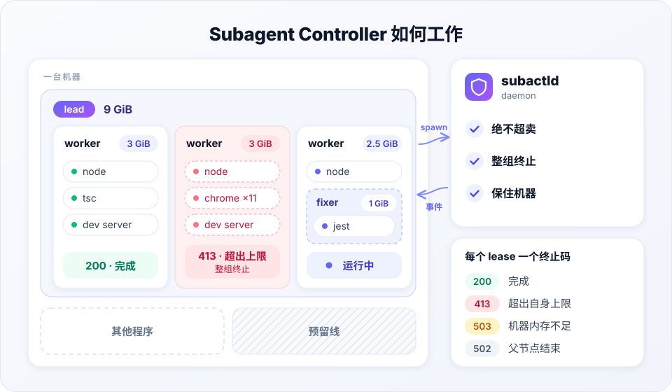

<h1 align="center">subactl</h1>

<p align="center"><b>Suba</b>gent <b>C</b>on<b>t</b>ro<b>l</b>ler：单机上的 AI agent 资源控制器，面向会派生其他 agent 的 agent</p>

<p align="center">
  <a href="https://github.com/zydo/subactl/actions/workflows/ci.yml"></a>
  <a href="LICENSE"></a>
</p>

<p align="center"><a href="README.md">English</a> | 中文</p>

> [!WARNING]
> subactl 仍处于早期开发阶段，尚不适合用于生产环境。它的 API、CLI 和磁盘上的数据格式仍可能在不另行通知的情况下变化。

<p align="center"></p>

coding agent 处理大任务时会扇出多个 subagent，每个 subagent 又会启动自己的进程：类型检查、测试、dev server、无头浏览器。在一台机器上，这会以几种熟悉的方式出问题：内存耗尽，内核随机杀掉某个进程，被杀的往往正是在干活的那个 agent；subagent 被 planner 叫停、撞上用量额度或崩溃时，它启动的进程继续运行，占着没人记账的内存；而 planner 在派下一个 worker 之前，也没有任何东西告诉它还剩多少余量。

subactl 把每个 agent 放进一个 **lease**：一组进程，带一个从父节点的配额里划出来的内存上限（envelope）。它守住三条承诺：

- **内存绝不超卖。** 只有配额放得下时 lease 才会被批准；超出自身上限的 lease 连同它下面的一切被终止，终止码 413，邻居察觉不到。
- **lease 结束时，其中的一切都会消失**：它启动的每个进程，不管用什么方式启动，以及它下面的每个 lease。
- **机器不会倒。** agent 以外的东西占走内存时，subactl 停止接纳新 lease、警告各个 planner；仍不够时，赶在内核动手之前一次终止一个 lease。

围绕这三条，还有：按实测峰值给出的建议配额、NEAR_LIMIT 预警、运行时长与输出量上限、说明每个 lease 为何结束的终止码、审计日志、Prometheus 指标、`subactl top` 与逐个 lease 的追溯，以及 agent 树的 inbox 与进度信标。`subactld` 是 daemon，`subactl` 是 CLI；唯一的契约是 [api/openapi.yaml](api/openapi.yaml)，Go client 在 [client](client)。

## 安装 agent skill

[subactl skill](skills/subactl/SKILL.md) 教 agent 通过 subactl 启动、确定配额、观察和结束子 agent。用 [skills](https://github.com/vercel-labs/skills) CLI 把它加到你的 agent：

```sh
npx skills add zydo/subactl --skill subactl
```

或者用 GitHub 的 CLI：

```sh
gh skill install zydo/subactl
```

skill 只教命令怎么用：agent 所在的机器还需要把 `subactl` 放进 `PATH`，并运行 `subactld`（见[试用](#试用)和[作为服务安装](#作为服务安装linux)）。

## 平台

subactl 只支持 **Linux 和 macOS**。在其他任何系统（包括 Windows）上，构建会立即失败，报错为 `undefined: subactl_supports_only_linux_and_macos`。

- **Linux** 强制执行：cgroup v2，每个 lease 一个 cgroup，内存硬限，内核侧整组终止，防逃逸，按 cgroup 归属认定身份。daemon 以 root 运行，可以由 systemd 托管。
- **macOS** 只做监控：没有 cgroup，backend 从进程表追踪每个 lease 的进程，每 200 毫秒检查一次它们的 physical footprint，超限的 lease 被终止。它把每项能力如实报告为 soft 或 monitor_only，要求硬性强制的请求会被拒绝。daemon 以普通用户运行。

## 效果如何

subactl 是对着一个基准测试开发的：一个精简的 multi-agent harness 把 [radix-ui/primitives](https://github.com/radix-ui/primitives) 组件库升级到 React 19，每个包一个 worker，每个 worker 起自己的 dev server 和浏览器，在一台物理 Linux 机器上 12GiB 的“爆炸舱”里运行。简要结果：

| | 完成的包 | 残留进程 | 舱内存耗尽 |
| --- | --- | --- | --- |
| 不用 subactl | 4% | 每次最多 116 个 | 每次都发生 |
| subactl，固定配额 | 41% | 从未有过 | 从未发生 |
| subactl，建议配额 | 53% | 从未有过 | 从未发生 |

换成真实模型来干活而不是剧本，结论一样：两种情况都完成了全部的包，但不用 subactl 时每次都留下 84 到 153 个进程、撑满了舱；用了 subactl 一次都没有。实验前设定的四个假设中，一个成立，两个被否证，一个在固定配额下成立、在建议配额下不成立；细节（包括没奏效的部分）见 [docs/benchmark.zh-CN.md](docs/benchmark.zh-CN.md)。

## 文档

- [docs/tutorial.zh-CN.md](docs/tutorial.zh-CN.md)：在 subactl 之上构建你自己的 multi-agent harness，附 shell 与 Go 的可运行示例。
- [docs/design.zh-CN.md](docs/design.zh-CN.md)：设计文档，实现与设计不同之处已标注。
- [docs/benchmark.zh-CN.md](docs/benchmark.zh-CN.md)：基准测试：任务、harness、实验设置、假设与结果。
- [docs/testing.zh-CN.md](docs/testing.zh-CN.md)：各测试套件，以及运行它们的 Linux 与 macOS 机器。
- [skills/subactl/SKILL.md](skills/subactl/SKILL.md)：agent skill，教 agent 如何使用 subactl（英文，供模型阅读）。
- [api/openapi.yaml](api/openapi.yaml)：API。

## 状态

所有里程碑均已完成：契约与 client（M0）、基线基准测试（M1）、Linux 强制执行（M2）、配额与可观测（M3）、agent 树与通信（M4）、实验（M5）、macOS backend（M6）。验收标准 F1 到 F33 每一条都有自动化测试，需要内核的在真实内核上运行。CPU 公平性（F27）在物理机上达标：旁边一个 lead 占满所有 CPU 时，另一个安静的 lead 的任务耗时上升 1% 到 2%，允许值为 20%。

## 试用

```sh
make build
export SUBACTL_SOCK=/tmp/subactl.sock
bin/subactld --backend fake --capacity 24G &   # 演练：不启动、也不强制任何东西
# 真实运行：Linux 上以 root 运行 "sudo bin/subactld"；macOS 上运行 "bin/subactld"。
bin/subactl host
bin/subactl run --wait=false --memory 8G -- agent     # 打印 lead 的 lease
bin/subactl spawn --parent <lead> --memory 2G -- worker
bin/subactl ls
bin/subactl terminate <lead> --grace 1s
```

使用基准测试的 harness：

```sh
# toy 场景不需要任何工具链，在哪都能跑。
bin/mini-agent --mode without --scenario examples/mini-agent/scenarios/toy.yaml

# 在 subactl 下：先启动 daemon（Linux 上用 root），再运行 lead。
sudo bin/subactld --socket-group "$(id -gn)" &
bin/mini-agent --mode with --scenario examples/mini-agent/scenarios/toy.yaml
bin/subactl top

# 用模型代替剧本，经由 Anthropic Messages API：Anthropic 自己的，或兼容端点。
# --provider 选择一个预设（bin/mini-agent -h 会列出），--base-url 和 --model
# 可以覆盖它，密钥从环境变量读取。
bin/mini-agent --mode with --brain real --prompt "..."
```

完整的基准测试怎么跑，见 [docs/benchmark.zh-CN.md](docs/benchmark.zh-CN.md#运行)。要构建自己的 harness，从[教程](docs/tutorial.zh-CN.md)开始。

## 作为服务安装（Linux）

```sh
sudo install -m 0755 bin/subactld bin/subactl /usr/local/bin/
sudo groupadd --system subactl          # 谁可以启动 agent
sudo groupadd --system subactl-admin    # 谁可以操作所有 lead
sudo install -m 0644 deploy/subactld.service /etc/systemd/system/
sudo systemctl daemon-reload && sudo systemctl enable --now subactld
```

这个 unit 在 daemon 死掉时立即重启它，并给它 -1000 的 OOM 分数。它的 lease 位于服务委派的 cgroup 里，所以 daemon 一死，systemd 就把它们一起清理掉：agent 启动的任何东西都活不过 daemon，不论 daemon 是否回来。

## 开发

```sh
make lint test
make integration   # Linux：用 sudo 运行；其他系统：在特权 Docker 容器里运行
```

项目只用 Go 标准库、`golang.org/x/sys` 和 `golang.org/x/term`；引入其他依赖时会有测试失败。`make lint` 还检查每个公开包在 Windows 和 FreeBSD 上都会以上面那条信息构建失败。
