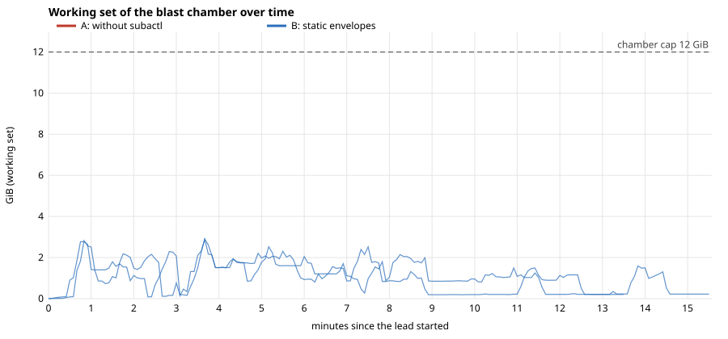
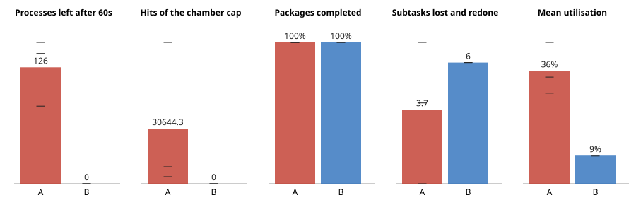

# Controlled experiment: results

Generated by `bench report` from the measurements in this directory. Nothing here is written by hand.

## Hypotheses

| | hypothesis | verdict | evidence |
| --- | --- | --- | --- |
| H1 | After the usage-limit kill, group A leaves processes behind in every run; groups B and C never do. | **undecided** | needs the results of groups A, B and C |
| H2 | Group A hits the chamber's own memory cap, or melts down, in at least one run; groups B and C never do. | **undecided** | needs the results of groups A, B and C |
| H3 | Group C's mean utilisation is at least 15 points above group B's, and it loses no more work. | **undecided** | needs the results of groups A, B and C |
| H4 | Under external interference, B and C use the safety net at most once per run, and planners are warned before it acts. | **undecided** | needs the results of groups A, B and C |

## Means by group

| group | runs | peak working set | cap hits | processes left | memory they held | completion | work lost | utilisation | safety net | makespan |
| --- | --- | --- | --- | --- | --- | --- | --- | --- | --- | --- |
| A: without subactl | 3 | 12.0 GiB | 30644.3 | 126.0 | 2.95 GiB | 100% | 3.7 | 36.0% | 0.0 | 9.0 min |
| B: static envelopes | 2 | 3.1 GiB | 0.0 | 0.0 | 0.21 GiB | 100% | 6.0 | 9.0% | 0.0 | 13.6 min |

## Every run

| group | run | peak working set | cap hits | OOM kills | meltdown | processes left | memory they held | completion | work lost | utilisation | safety net | termination codes |
| --- | --- | --- | --- | --- | --- | --- | --- | --- | --- | --- | --- | --- |
| A | 1 | 12.0 GiB | 3938 | 77 | false | 153 | 4.25 GiB | 100% (of 8) | 0 | 45.0% | 0 |  |
| A | 2 | 12.0 GiB | 78563 | 339 | false | 84 | 1.66 GiB | 100% (of 8) | 4 | 34.0% | 0 |  |
| A | 3 | 12.0 GiB | 9432 | 219 | false | 141 | 2.94 GiB | 100% (of 8) | 7 | 28.9% | 0 |  |
| B | 1 | 3.1 GiB | 0 | 475 | false | 0 | 0.21 GiB | 100% (of 8) | 6 | 8.8% | 0 | 200×8 413×4 520×2 |
| B | 2 | 3.2 GiB | 0 | 457 | false | 0 | 0.22 GiB | 100% (of 8) | 6 | 9.1% | 0 | 200×8 413×4 520×2 |

The one-second series of every run is in `series.parquet` (columns: group, run, t, ws, agents_ws, pids, oom_kills, cap_hits; memory is working set in bytes).
