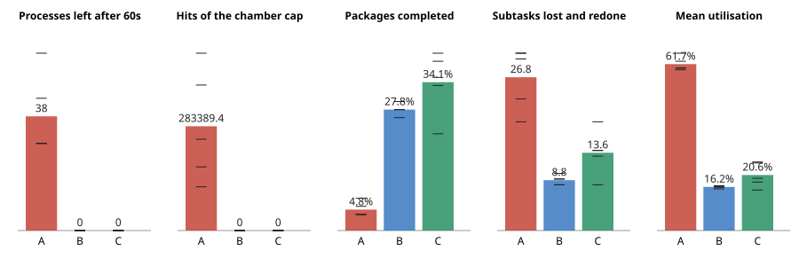

# Controlled experiment: results

Generated by `bench report` from the measurements in this directory. Nothing here is written by hand.

## Hypotheses

| | hypothesis | verdict | evidence |
| --- | --- | --- | --- |
| H1 | After the usage-limit kill, group A leaves processes behind in every run; groups B and C never do. | **refuted** | processes left after 60s, per run. A: 38, 55, 0, 12, 116. B: 0, 0, 0, 0, 0. C: 0, 0, 0, 0, 0. |
| H2 | Group A hits the chamber's own memory cap, or melts down, in at least one run; groups B and C never do. | **holds** | times the chamber's own cap was hit, per run. A: 372374, 940441, 1447150, 792112, 1358736. B: 0, 0, 0, 0, 0. C: 0, 0, 0, 0, 0. |
| H3 | Group C's mean utilisation is at least 15 points above group B's, and it loses no more work. | **refuted** | mean utilisation B 14.3%, C 18.6% (difference +4.3 points, 15 needed); mean work lost B 15.2, C 21.4 subtasks. |
| H4 | Under external interference, B and C use the safety net at most once per run, and planners are warned before it acts. | **holds** | safety-net terminations per run. B: 0, 0, 0, 0, 0. C: 0, 0, 0, 0, 0. |

## Means by group

| group | runs | peak working set | cap hits | processes left | memory they held | completion | work lost | utilisation | safety net | makespan |
| --- | --- | --- | --- | --- | --- | --- | --- | --- | --- | --- |
| A: without subactl | 5 | 12.0 GiB | 982162.6 | 44.2 | 1.77 GiB | 4% | 12.8 | 31.7% | 0.0 | 15.0 min |
| B: static envelopes | 5 | 5.7 GiB | 0.0 | 0.0 | 0.62 GiB | 41% | 15.2 | 14.3% | 0.0 | 15.0 min |
| C: suggested envelopes that grow | 5 | 6.5 GiB | 0.0 | 0.0 | 0.83 GiB | 53% | 21.4 | 18.6% | 0.0 | 15.0 min |
| L: a model as planner | 5 | 6.2 GiB | 0.0 | 0.0 | 0.37 GiB | 24% | 15.6 | 10.2% | 0.0 | 13.5 min |

## Every run

| group | run | peak working set | cap hits | OOM kills | meltdown | processes left | memory they held | completion | work lost | utilisation | safety net | termination codes |
| --- | --- | --- | --- | --- | --- | --- | --- | --- | --- | --- | --- | --- |
| A | 1 | 12.0 GiB | 372374 | 1609 | false | 38 | 1.88 GiB | 6% (of 54) | 1 | 26.0% | 0 |  |
| A | 2 | 12.0 GiB | 940441 | 1901 | false | 55 | 2.16 GiB | 6% (of 54) | 5 | 33.0% | 0 |  |
| A | 3 | 12.0 GiB | 1447150 | 2540 | false | 0 | 0.11 GiB | 0% (of 54) | 31 | 29.2% | 0 |  |
| A | 4 | 12.0 GiB | 792112 | 1718 | false | 12 | 0.68 GiB | 2% (of 54) | 2 | 23.1% | 0 |  |
| A | 5 | 12.0 GiB | 1358736 | 2577 | false | 116 | 4.03 GiB | 9% (of 54) | 25 | 47.1% | 0 |  |
| B | 1 | 6.0 GiB | 0 | 1431 | false | 0 | 0.63 GiB | 41% (of 54) | 16 | 15.5% | 0 | 200×51 413×14 414×1 499×2 502×4 520×44 |
| B | 2 | 5.2 GiB | 0 | 1008 | false | 0 | 0.63 GiB | 41% (of 54) | 13 | 14.3% | 0 | 200×51 413×11 414×1 499×2 502×3 520×44 |
| B | 3 | 5.4 GiB | 0 | 1433 | false | 0 | 0.59 GiB | 39% (of 54) | 16 | 14.8% | 0 | 200×52 413×14 414×1 499×2 502×3 520×44 |
| B | 4 | 6.7 GiB | 0 | 1235 | false | 0 | 0.64 GiB | 43% (of 54) | 15 | 12.2% | 0 | 200×52 413×13 414×1 499×2 520×44 |
| B | 5 | 5.1 GiB | 0 | 1444 | false | 0 | 0.63 GiB | 43% (of 54) | 16 | 14.5% | 0 | 200×54 413×14 414×1 499×2 520×44 |
| C | 1 | 6.3 GiB | 0 | 1766 | false | 0 | 0.83 GiB | 54% (of 54) | 23 | 16.8% | 0 | 200×66 413×20 414×1 499×3 502×3 520×40 |
| C | 2 | 6.5 GiB | 0 | 1930 | false | 0 | 0.90 GiB | 57% (of 54) | 22 | 20.0% | 0 | 200×73 413×19 414×1 499×3 502×1 520×42 |
| C | 3 | 6.7 GiB | 0 | 1588 | false | 0 | 0.89 GiB | 57% (of 54) | 19 | 18.3% | 0 | 200×70 413×16 414×1 499×3 502×4 520×41 |
| C | 4 | 6.6 GiB | 0 | 1634 | false | 0 | 0.79 GiB | 50% (of 54) | 21 | 18.4% | 0 | 200×63 413×18 414×1 499×3 502×5 520×41 |
| C | 5 | 6.2 GiB | 0 | 1777 | false | 0 | 0.72 GiB | 48% (of 54) | 22 | 19.5% | 0 | 200×59 413×19 414×1 499×3 502×4 520×43 |
| L | 1 | 6.4 GiB | 0 | 2010 | false | 0 | 0.62 GiB | 39% (of 54) | 26 | 13.3% | 0 | 200×47 413×22 499×1 502×10 520×9 |
| L | 2 | 6.1 GiB | 0 | 1823 | false | 0 | 0.25 GiB | 15% (of 54) | 20 | 6.7% | 0 | 200×24 413×18 499×1 520×2 |
| L | 3 | 6.7 GiB | 0 | 1135 | false | 0 | 0.45 GiB | 30% (of 54) | 15 | 11.8% | 0 | 200×38 413×13 414×1 502×5 520×4 |
| L | 4 | 5.1 GiB | 0 | 616 | false | 0 | 0.34 GiB | 24% (of 54) | 9 | 8.7% | 0 | 200×35 413×6 414×1 520×5 |
| L | 5 | 6.6 GiB | 0 | 322 | false | 0 | 0.20 GiB | 11% (of 54) | 8 | 10.4% | 0 | 200×18 413×3 502×3 520×8 |

The one-second series of every run is in `series.parquet` (columns: group, run, t, ws, agents_ws, pids, oom_kills, cap_hits; memory is working set in bytes).
