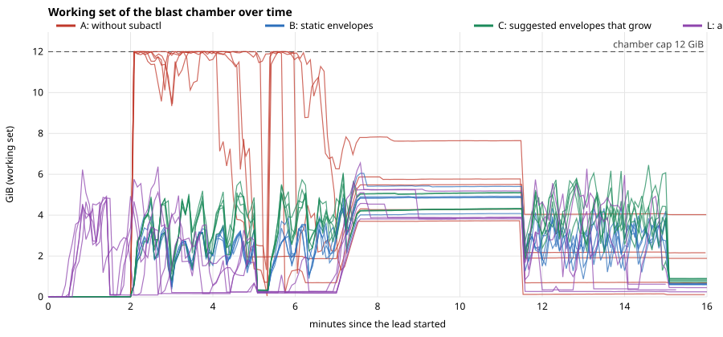

# Controlled experiment: results

Generated by `bench report` from the measurements in this directory. Nothing here is written by hand.

## Hypotheses

| | hypothesis | verdict | evidence |
| --- | --- | --- | --- |
| H1 | After the usage-limit kill, group A leaves processes behind in every run; groups B and C never do. | **holds** | processes left after 60s, per run. A: 59, 29, 29, 44, 29. B: 0, 0, 0, 0, 0. C: 0, 0, 0, 0, 0. |
| H2 | Group A hits the chamber's own memory cap, or melts down, in at least one run; groups B and C never do. | **holds** | times the chamber's own cap was hit, per run. A: 481754, 248193, 172979, 395373, 118648. B: 0, 0, 0, 0, 0. C: 0, 0, 0, 0, 0. |
| H3 | Group C's mean utilisation is at least 15 points above group B's, and it loses no more work. | **refuted** | mean utilisation B 16.2%, C 20.6% (difference +4.4 points, 15 needed); mean work lost B 8.8, C 13.6 subtasks. |
| H4 | Under external interference, B and C use the safety net at most once per run, and planners are warned before it acts. | **holds** | safety-net terminations per run. B: 0, 0, 0, 0, 0. C: 0, 0, 0, 0, 0. |

## Means by group

| group | runs | peak working set | cap hits | processes left | memory they held | completion | work lost | utilisation | safety net | makespan |
| --- | --- | --- | --- | --- | --- | --- | --- | --- | --- | --- |
| A: without subactl | 5 | 12.0 GiB | 283389.4 | 38.0 | 2.39 GiB | 5% | 26.8 | 61.7% | 0.0 | 15.0 min |
| B: static envelopes | 5 | 6.5 GiB | 0.0 | 0.0 | 0.51 GiB | 28% | 8.8 | 16.2% | 0.0 | 15.0 min |
| C: suggested envelopes that grow | 5 | 7.2 GiB | 0.0 | 0.0 | 0.57 GiB | 34% | 13.6 | 20.6% | 0.0 | 15.0 min |

## Every run

| group | run | peak working set | cap hits | OOM kills | meltdown | processes left | memory they held | completion | work lost | utilisation | safety net | termination codes |
| --- | --- | --- | --- | --- | --- | --- | --- | --- | --- | --- | --- | --- |
| A | 1 | 12.0 GiB | 481754 | 1214 | false | 59 | 2.88 GiB | 7% (of 54) | 31 | 65.7% | 0 |  |
| A | 2 | 12.0 GiB | 248193 | 1118 | false | 29 | 1.46 GiB | 4% (of 54) | 23 | 59.6% | 0 |  |
| A | 3 | 12.0 GiB | 172979 | 1242 | false | 29 | 2.70 GiB | 4% (of 54) | 31 | 62.7% | 0 |  |
| A | 4 | 12.0 GiB | 395373 | 1147 | false | 44 | 2.06 GiB | 6% (of 54) | 19 | 60.2% | 0 |  |
| A | 5 | 12.0 GiB | 118648 | 1138 | false | 29 | 2.85 GiB | 4% (of 54) | 30 | 60.3% | 0 |  |
| B | 1 | 6.6 GiB | 0 | 304 | false | 0 | 0.50 GiB | 30% (of 54) | 8 | 16.5% | 0 | 200×39 413×6 499×2 502×4 520×48 |
| B | 2 | 5.5 GiB | 0 | 319 | false | 0 | 0.49 GiB | 26% (of 54) | 8 | 15.4% | 0 | 200×37 413×6 499×2 520×47 |
| B | 3 | 6.7 GiB | 0 | 356 | false | 0 | 0.51 GiB | 28% (of 54) | 9 | 16.6% | 0 | 200×36 413×7 499×2 502×4 520×47 |
| B | 4 | 6.7 GiB | 0 | 359 | false | 0 | 0.54 GiB | 28% (of 54) | 9 | 16.3% | 0 | 200×39 413×7 499×2 520×48 |
| B | 5 | 6.9 GiB | 0 | 395 | false | 0 | 0.52 GiB | 28% (of 54) | 10 | 16.0% | 0 | 200×38 413×8 499×3 520×47 |
| C | 1 | 7.2 GiB | 0 | 562 | false | 0 | 0.53 GiB | 33% (of 54) | 13 | 18.0% | 0 | 200×40 413×11 414×1 499×3 502×3 520×49 |
| C | 2 | 7.3 GiB | 0 | 776 | false | 0 | 0.68 GiB | 39% (of 54) | 19 | 25.0% | 0 | 200×51 413×15 414×1 499×3 502×3 520×44 |
| C | 3 | 7.3 GiB | 0 | 583 | false | 0 | 0.63 GiB | 41% (of 54) | 14 | 25.4% | 0 | 200×54 413×11 414×1 499×2 520×43 |
| C | 4 | 7.7 GiB | 0 | 337 | false | 0 | 0.44 GiB | 22% (of 54) | 8 | 15.0% | 0 | 200×30 413×6 499×3 502×6 520×48 |
| C | 5 | 6.4 GiB | 0 | 664 | false | 0 | 0.57 GiB | 35% (of 54) | 14 | 19.4% | 0 | 200×41 413×12 414×1 499×2 520×44 |

The one-second series of every run is in `series.parquet` (columns: group, run, t, ws, agents_ws, pids, oom_kills, cap_hits; memory is working set in bytes).
