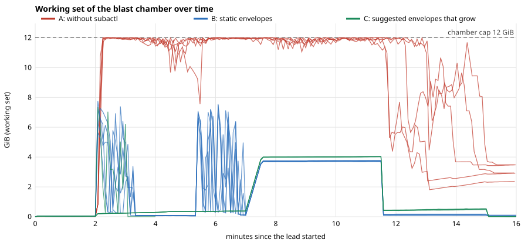
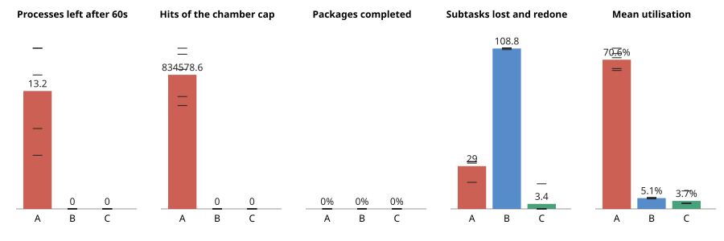

# Controlled experiment: results

Generated by `bench report` from the measurements in this directory. Nothing here is written by hand.

## Hypotheses

| | hypothesis | verdict | evidence |
| --- | --- | --- | --- |
| H1 | After the usage-limit kill, group A leaves processes behind in every run; groups B and C never do. | **holds** | processes left after 60s, per run. A: 6, 18, 9, 15, 18. B: 0, 0, 0, 0, 0. C: 0, 0, 0, 0, 0. |
| H2 | Group A hits the chamber's own memory cap, or melts down, in at least one run; groups B and C never do. | **holds** | times the chamber's own cap was hit, per run. A: 698944, 868524, 642980, 999896, 962549. B: 0, 0, 0, 0, 0. C: 0, 0, 0, 0, 0. |
| H3 | Group C's mean utilisation is at least 15 points above group B's, and it loses no more work. | **refuted** | mean utilisation B 5.1%, C 3.7% (difference -1.3 points, 15 needed); mean work lost B 108.8, C 3.4 subtasks. |
| H4 | Under external interference, B and C use the safety net at most once per run, and planners are warned before it acts. | **holds** | safety-net terminations per run. B: 0, 0, 0, 0, 0. C: 0, 0, 0, 0, 0. |

## Means by group

| group | runs | peak working set | cap hits | processes left | memory they held | completion | work lost | utilisation | safety net | makespan |
| --- | --- | --- | --- | --- | --- | --- | --- | --- | --- | --- |
| A: without subactl | 5 | 12.0 GiB | 834578.6 | 13.2 | 3.04 GiB | 0% | 29.0 | 70.6% | 0.0 | 15.0 min |
| B: static envelopes | 5 | 7.8 GiB | 0.0 | 0.0 | 0.06 GiB | 0% | 108.8 | 5.1% | 0.0 | 15.0 min |
| C: suggested envelopes that grow | 5 | 5.0 GiB | 0.0 | 0.0 | 0.00 GiB | 0% | 3.4 | 3.7% | 0.0 | 12.6 min |

## Every run

| group | run | peak working set | cap hits | OOM kills | meltdown | processes left | memory they held | completion | work lost | utilisation | safety net | termination codes |
| --- | --- | --- | --- | --- | --- | --- | --- | --- | --- | --- | --- | --- |
| A | 1 | 12.0 GiB | 698944 | 3628 | false | 6 | 2.38 GiB | 0% (of 54) | 31 | 65.5% | 0 |  |
| A | 2 | 12.0 GiB | 868524 | 3543 | false | 18 | 3.47 GiB | 0% (of 54) | 32 | 71.5% | 0 |  |
| A | 3 | 12.0 GiB | 642980 | 3607 | false | 9 | 2.92 GiB | 0% (of 54) | 18 | 66.4% | 0 |  |
| A | 4 | 12.0 GiB | 999896 | 3708 | false | 15 | 2.94 GiB | 0% (of 54) | 32 | 73.5% | 0 |  |
| A | 5 | 12.0 GiB | 962549 | 3637 | false | 18 | 3.48 GiB | 0% (of 54) | 32 | 76.0% | 0 |  |
| B | 1 | 8.0 GiB | 0 | 5525 | false | 0 | 0.10 GiB | 0% (of 54) | 108 | 4.7% | 0 | 200×1 413×108 499×1 520×1 |
| B | 2 | 7.8 GiB | 0 | 5403 | false | 0 | 0.05 GiB | 0% (of 54) | 109 | 5.4% | 0 | 200×1 413×108 499×1 520×1 |
| B | 3 | 7.9 GiB | 0 | 5425 | false | 0 | 0.05 GiB | 0% (of 54) | 109 | 5.2% | 0 | 200×1 413×108 499×1 520×1 |
| B | 4 | 7.9 GiB | 0 | 5497 | false | 0 | 0.04 GiB | 0% (of 54) | 109 | 4.8% | 0 | 200×1 413×108 499×1 520×1 |
| B | 5 | 7.6 GiB | 0 | 5538 | false | 0 | 0.04 GiB | 0% (of 54) | 109 | 5.3% | 0 | 200×1 413×108 499×1 520×1 |
| C | 1 | 8.7 GiB | 0 | 1013 | false | 0 | 0.00 GiB | 0% (of 54) | 17 | 8.5% | 0 | 413×17 502×1 |
| C | 2 | 4.0 GiB | 0 | 0 | false | 0 | 0.00 GiB | 0% (of 54) | 0 | 2.5% | 0 | 200×1 |
| C | 3 | 4.0 GiB | 0 | 0 | false | 0 | 0.00 GiB | 0% (of 54) | 0 | 2.5% | 0 | 200×1 |
| C | 4 | 4.0 GiB | 0 | 0 | false | 0 | 0.00 GiB | 0% (of 54) | 0 | 2.6% | 0 | 200×1 |
| C | 5 | 4.1 GiB | 0 | 0 | false | 0 | 0.01 GiB | 0% (of 54) | 0 | 2.6% | 0 | 200×1 |

The one-second series of every run is in `series.parquet` (columns: group, run, t, ws, agents_ws, pids, oom_kills, cap_hits; memory is working set in bytes).
